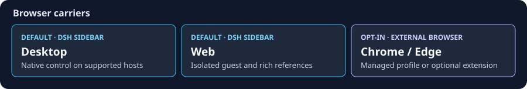

<p align="center">
  
  
  
  
</p>

<p align="center"><sub><a href="README.md">中文</a> · English</sub></p>

# Browser plugin for DeepSeek Harness

Browse in the DSH sidebar, send rich page selections into a conversation, and let the agent operate the same page on supported Desktop hosts. Tabs and action history belong to the task. [1.0.0 release changes](CHANGELOG.md#未发布)



## Quick start

Desktop and Web use separate DSH profiles. These commands install the version currently published on npm:

```sh
dsh plugin --profile desktop add dsh-builtin-browser
dsh plugin --profile web add dsh-builtin-browser
```

If it is already installed, [remove it from that profile before adding the target version](docs/user-guide.md#先移除再安装).

**Desktop (Windows and macOS).** Keep **DSH Sidebar** selected. If the bridge needs repair, save active work and use **Settings → Browser → Uninstall and reinstall** when available. On supported builds this can apply the bundled host patch; it changes local DSH files and is not required to use Chrome or Edge. DSH asks before quitting an active task. After a host update, check bridge status again.

**Web (`dsh web`).** Open the browser from the DSH sidebar. You can navigate and send selections from the isolated guest. Desktop-native tooling and opener-dependent child tabs are not available in this guest. Use a supported Desktop sidebar or explicitly select a local browser when a task requires CDP.

## Choose a browser

| Option | How it works |
| --- | --- |
| DSH Sidebar (default) | Uses the selected host's sidebar. If the needed capability is missing, it reports why instead of opening another window. |
| Chrome / Edge | Uses a DSH-managed profile by default. If you prefer your own browser, the optional extension can use its sign-in state; when the extension is unavailable, a new session uses the managed profile. |
| Bundled / Auto (legacy values) | Both now mean sidebar only. Neither downloads Electron or picks an external browser. |

## Quote a page in chat

Select text in the sidebar, then use the floating bar to add it to the conversation. Supported selections retain paragraph, link, table and formula formatting. Sent references stay as capsules, without duplicated quote text. Hover for a preview or choose **Return to source** to reopen the page and locate the selection. If the source has changed, the saved preview is still available.

## Browser settings

- **Environment check** shows the selected carrier, the bridge status, and the detected Chrome and Edge executables.
- **Quiet mode** avoids raising the host window. With DSH sidebar selected, opening a URL reveals the target conversation's sidebar page; explicit tab switching selects the corresponding sidebar tab. Window behavior applies only to explicitly selected external browsers.
- **Presentation** controls sidebar expansion, closing the browser with the session, the agent cursor, and remote viewing.
- **Agent permissions** controls page scripts, downloads, and reading or writing sign-in state.
- **Advanced settings** covers browsing history, permission for coordinate clicks and drags, and sign-in persistence and window mode for explicitly selected Chrome or Edge. The delivery form validates and saves the tool name, argument template, failure policy, and per-site rules together.

On the local machine or in an isolated test environment, turn on **Allow remote viewing** and open the DSH viewer for a read-only view of the browser session. The viewer refreshes JPEG frames up to twice per second.

## Download delivery

In **Advanced settings → Delivery**, enter an upload tool registered in DSH and configure its destination arguments. Automatic delivery uses the DSH native tool executor and retains the current task's tool permissions. The result includes the local download path and the upload tool's complete return value.

DSH sidebar downloads use the target page's authenticated browser session, stream to a temporary file, and commit the completed file while preserving existing destinations.

The official Baidu Netdisk stdio MCP upload tool accepts this argument template:

```json
{
  "local_file_path": "{path}",
  "remote_path": "/来自：mcp_server/DSH下载"
}
```

`{path}` becomes the downloaded file's absolute path. `remote_path` names the destination folder. Use the tool name actually registered in DSH, following `mcp__<serverName>__upload_file`. [Baidu Netdisk MCP parameters](https://github.com/baidu-netdisk/mcp)

For Feishu, configure an MCP tool that provides file uploads and use the argument fields it declares.

## Browser tools

Common `dsh_browser_*` tools are loaded by default. Use `dsh_browser_load_tools` for less common groups and `dsh_browser_do` for a fixed action list. For loops, branches, or independent reads in parallel, use `dsh_browser_code` in standard DSH mode or DSH's `run_code` in PTC mode.

When a site needs a login, CAPTCHA or other human verification, ask the agent to request takeover. The plugin does not solve challenges automatically.

## Documentation

- [User guide](docs/user-guide.md)
- [Tool parameters and examples](docs/tool-reference.md)
- [Choosing tools, locating elements, and running steps](skills/dsh-builtin-browser/SKILL.md)
- [Architecture](docs/architecture.md)
- [Compatibility and operating conditions](docs/limitations.md)
- [Build and test](docs/development.md)

A community plugin built on [DeepSeek Harness](https://github.com/deepseek-ai/deepseek-harness) and [Cordis](https://github.com/cordiverse/cordis). Thanks to everyone who contributed issue reports, reproduction steps, and patches.

Author on WeChat **hui13866591135** · [MIT License](LICENSE)
