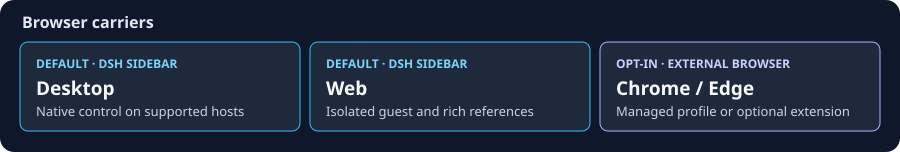

<p align="center">
  
  
  
  
</p>

<p align="center"><sub>中文 · <a href="README.en.md">English</a></sub></p>

# DeepSeek Harness 浏览器插件

在 DSH 侧栏浏览网页，把保留格式的选区加入对话。桌面宿主支持时，Agent 操作的就是你正在看的页面；标签和操作历史归各自任务。[1.0.0 更新记录](CHANGELOG.md#未发布)



## 快速开始

Desktop 和 Web 使用独立的 DSH profile。下列命令安装 npm 当前发布的版本：

```sh
dsh plugin --profile desktop add dsh-builtin-browser
dsh plugin --profile web add dsh-builtin-browser
```

若插件已安装，请在目标 profile [先移除，再添加目标版本](docs/user-guide.md#先移除再安装)。

**桌面端（Windows / macOS）。** 默认使用 **DSH 侧栏**。桥接需要修复时，保存进行中的工作，在 **设置 → 浏览器** 使用可用的 **卸载并重装**。受支持的构建可借此应用随插件附带的宿主补丁；这会修改本机 DSH 文件，使用 Chrome 或 Edge 不需要该补丁。有任务运行时，是否退出由 DSH 提示、用户确认。宿主更新后请重新检查桥接状态。

**Web 端（`dsh web`）。** 从 DSH 侧栏打开浏览器，可在隔离页面内导航、选择内容并发送引用。该页面不提供原生 CDP 能力，也不支持依赖 opener 的子标签。任务确实需要 CDP 时，请使用受支持的桌面侧栏，或显式选择本机浏览器。

## 选择浏览器

| 选项 | 使用方式 |
| --- | --- |
| DSH 侧栏（默认） | 使用所在宿主的侧栏。缺少所需能力时说明原因，不另开浏览器窗口。 |
| 本机 Chrome / Edge | 默认使用 DSH 管理的独立浏览器配置。偏好自己的浏览器时，可用可选扩展复用登录态；扩展不可用时，新会话使用独立配置。 |
| 内置浏览器 / 自动（旧设置） | 都是仅侧栏的兼容别名，不下载 Electron，也不自动选择外部浏览器。 |

## 把网页内容引用到对话

在侧栏划选网页内容，再用浮条将选区加入对话。支持的选区保留段落、链接、表格和公式等格式。发送后只显示引用胶囊，不再重复引用正文；悬停可预览，点击 **回到原页面** 可打开来源并定位选区。原文改变时仍可查看已保存的预览。

## 浏览器设置

- **环境检查** 显示所选载体、侧栏桥接状态以及找到的 Chrome / Edge。
- **安静模式** 避免抬起宿主窗口。选择 DSH 侧栏后，打开网址会展示目标会话的侧栏页面，显式切换标签会选择对应的侧栏标签。外部浏览器窗口行为仅适用于显式选择的 Chrome / Edge。
- **展示** 提供侧栏自动展开、随会话关闭浏览器、Agent 光标和远程观看开关。
- **Agent 权限** 控制页面脚本、文件下载和登录状态的读写。
- **高级设置** 提供浏览历史、坐标点击与拖拽许可，以及显式选择的 Chrome、Edge 的登录状态保留和窗口模式。交付表单可以设置工具名、参数模板、失败处理和站点规则，校验后一次保存。

在本机或隔离测试环境中打开 **允许远程观看**，通过 DSH 的观看入口查看会话的只读画面。画面以 JPEG 刷新，最高每秒 2 帧。

## 下载交付

在 **高级设置 → 交付** 中填入已接入 DSH 的上传工具名，并根据该工具的参数设置目标目录。自动交付使用 DSH 原生工具执行器，保留当前任务的工具权限。文件先保存到本地，再交给所选工具，结果中包含本地路径和上传工具的完整返回值。

DSH 侧栏下载使用目标页面所属浏览器会话的登录状态，分段保存文件并在完成后提交到目标位置，保留已有的同名文件。

例如，百度网盘官方 stdio MCP 的上传工具使用下面的参数模板：

```json
{
  "local_file_path": "{path}",
  "remote_path": "/来自：mcp_server/DSH下载"
}
```

`{path}` 会替换为已下载文件的完整路径。`remote_path` 是网盘目标文件夹。工具名采用 DSH 中实际注册的名称，格式为 `mcp__<serverName>__upload_file`。[百度网盘 MCP 参数](https://github.com/baidu-netdisk/mcp)

飞书目标可配置具备文件上传能力的 MCP 工具，参数模板按该工具声明的字段填写。

## 浏览器工具

常用 `dsh_browser_*` 工具默认可用。用 `dsh_browser_load_tools` 按组加载其余工具，或用 `dsh_browser_do` 执行固定步骤。需要循环、条件分支或并发读取时，标准模式用 `dsh_browser_code`，DSH PTC 模式用宿主的 `run_code`。

遇到登录、验证码等需要人工完成的操作，请让 Agent 请求接管；插件不会自动解决验证。

## 文档

- [用户指南](docs/user-guide.md)
- [工具参数与示例](docs/tool-reference.md)
- [工具选择、页面定位与操作步骤](skills/dsh-builtin-browser/SKILL.md)
- [架构说明](docs/architecture.md)
- [兼容性与使用条件](docs/limitations.md)
- [构建和测试](docs/development.md)

本项目是基于 [DeepSeek Harness](https://github.com/deepseek-ai/deepseek-harness) 和 [Cordis](https://github.com/cordiverse/cordis) 的社区插件。感谢提交问题、复现步骤和补丁的贡献者。

作者微信 **hui13866591135** · [MIT 许可](LICENSE)
