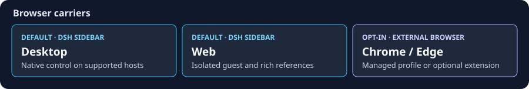

# 浏览器架构

## 会话、载体、工具

- **会话归属：** 每个任务有自己的标签与操作记录。句柄携带会话和标签身份，但不是授权凭据。宿主仍会验证发起方、侧栏位置与有效租约；会话结束、渲染器重载或页面销毁会让旧句柄失效。
- **载体选择：** 默认、`auto` 和 `bundled` 仅用 DSH 侧栏。宿主提供什么能力，就使用什么能力；不会用新窗口或别的会话替代。只有显式选择 Chrome / Edge 才走系统浏览器。旧版 `RemoteElectronViewHost` 源码仅用于历史兼容测试，不属于默认启动路径。
- **工具分发：** 原生调用、`dsh_browser_do` 和代码批处理共用工具权限与任务会话。默认只注册常用工具，其余按组加载且不再卸载。标准模式的 JavaScript REPL 按任务隔离；同一任务的单元串行执行，单元内独立读取可并行，动作保留顺序。PTC 模式下默认使用宿主 `run_code`。

## Desktop：宿主分配并组合原生页面

支持的宿主通过 Desktop main extension API 启动 profile 里的桥接入口，提供受限的快照、命令、下载和释放能力，不把裸 `WebContents` 交给工具。原生视图在 DSH 现有窗口的侧栏槽内渲染；槽负责裁剪、大小和可见性，页面身份在正式导航完成后才交给工具。对话未被选中时，可使用宿主的渲染保留接口，在不抢焦点的前提下维持页面；旧宿主仍可能要求先选中对话。

原生子标签沿用同一套归属与租约。Chromium 创建的子页被接入原侧栏，而不是拿 URL 重新打开一份页面。详见[子标签契约](child-tabs.md)。

## Web：隔离 guest 与引用通道

手动 Web 浏览使用代理和 opaque-origin iframe，站点 Cookie 由代理负责，不与 DSH 应用认证共享。选区与回到原文指令通过校验的消息通道与所属对话交互；跨导航时必须匹配当前页面身份。引用先冻结结构化内容，再经同一个预览与定位流程供草稿、已发送消息和原文回跳使用。已发胶囊不需要重新抓取页面来还原预览。

Web 不提供原生子页或 CDP 工具。不能提供的能力显式报错，无独立 Electron 进程回退。

## 显式选择 Chrome / Edge

默认 CDP 载体使用 DSH 管理的独立配置。个人配置模式在新会话首次操作时尝试可选扩展，扩展未连接则该会话固定用独立配置的 CDP。扩展连接通过 Native Messaging；切换任务时调试连接按租约复用和释放。关闭任务不会关闭用户原有的浏览器窗口或标签。

## 宿主维护

宿主补丁随插件分发，仅在显式维护时应用。版本、目标文件和适用的备份均须校验；目标冲突时拒绝写入。桌面维护在应用退出后执行，并重启验证桥接。补丁不会在浏览器载体选择或插件启动时自动应用。

[用户指南](user-guide.md) · [兼容性与边界](limitations.md) · [工具参考](tool-reference.md)
